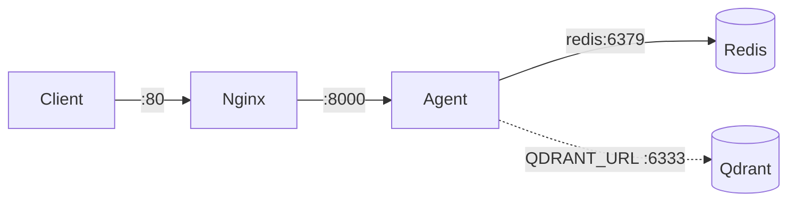

# Day 14 Lab — Mission Answers

> Lớp K5-L3B. Output và số đo dưới đây lấy từ lần chạy ngày 2026-11-26 trên WSL2 Ubuntu + Docker 29.8.2.

## Part 1: Localhost vs Production

### Exercise 1.1: Anti-patterns trong `01-localhost-vs-production/develop/app.py`
1. **Hardcode secret** (dòng 17–18): `OPENAI_API_KEY` và `DATABASE_URL` có mật khẩu nằm ngay trong code, push lên Git là lộ.
2. **Không quản lý config** (dòng 21–22): `DEBUG`, `MAX_TOKENS` viết cứng, muốn đổi phải sửa code.
3. **`print()` thay cho logging** (dòng 33–38), và dòng 34 in cả API key ra log.
4. **Không có health check:** không có `/health`, platform không biết khi nào cần restart.
5. **`host="localhost"`** (dòng 51): chạy trong container thì bên ngoài không gọi vào được.
6. **Cổng cố định `8000`** (dòng 52): không đọc biến `PORT` do platform cấp.
7. **`reload=True`** (dòng 53): chế độ dành cho lúc phát triển.
8. **Không có xử lý shutdown:** không có lifespan hay bước dọn kết nối.

### Exercise 1.2: Chạy bản develop

`POST /ask?question=Hello` trả 200, `GET /health` trả 404. Log thật in cả key ra (key này là chuỗi giả có sẵn trong đề):

```text
POST /ask?question=Hello -> HTTP/1.1 200 OK
GET /health -> {"detail":"Not Found"} [404]
[DEBUG] Got question: Hello
[DEBUG] Using key: sk-hardcoded-fake-key-never-do-this
```

App chạy được nhưng chưa sẵn sàng cho production.

### Exercise 1.3: So sánh develop và production

| Feature | Develop | Production | Vì sao quan trọng |
|---|---|---|---|
| Config | Viết cứng trong code | Đọc từ env qua `config.py` | Cùng một bản build chạy được ở mọi môi trường, secret không vào Git |
| Health check | Không có | `/health` và `/ready` | Platform biết khi nào restart, khi nào ngừng gửi traffic |
| Logging | `print()`, in cả secret | Log dạng JSON, chỉ ghi độ dài câu hỏi | Lọc và tìm được log, không lộ dữ liệu |
| Shutdown | Không xử lý | Lifespan + bắt `SIGTERM` | Giảm nguy cơ cắt ngang request khi deploy bản mới |
| Host / Port | `localhost:8000` | `0.0.0.0` và `PORT` từ env | Chạy được trong container và trên cloud |

App production của Part 1 chưa có xác thực cho `/ask`; phần này được bổ sung ở Part 4 và Part 6. Khi chạy thử bản production: `/ask`, `/health`, `/ready` đều trả 200.

## Part 2: Docker

### Exercise 2.1 (`02-docker/develop/Dockerfile`)
1. **Base image:** `python:3.11`, bản Python đầy đủ.
2. **Working directory:** `/app`.
3. **Vì sao `COPY requirements.txt` đứng trước:** để tận dụng layer cache. Khi chỉ code thay đổi, layer `pip install` được dùng lại, không phải cài lại thư viện.
4. **`CMD` và `ENTRYPOINT`:** `CMD` là lệnh hoặc tham số mặc định, bị thay khi thêm đối số sau `docker run <image>`. `ENTRYPOINT` là chương trình chính của container; đối số của `docker run` được nối vào sau nó, muốn thay phải dùng `--entrypoint`.

### Exercise 2.2: Build và chạy container develop

Lệnh trong đề gửi JSON body thì nhận **422**, vì app này đọc `question` từ query string. Gọi đúng:

```text
POST /ask?question=What+is+Docker  -> 200
{"answer":"Container là cách đóng gói app để chạy ở mọi nơi. Build once, run anywhere!"}
```

### Exercise 2.3: Kích thước image

| Image | `docker images` | Bytes (`docker image inspect`) |
|---|---:|---:|
| develop (single-stage) | 1.67 GB | 1,667,779,744 |
| production (multi-stage) | 240 MB | 239,811,317 |

Production nhỏ hơn **85,6%**. Stage `builder` cài `gcc`, `libpq-dev` và thư viện Python. Stage `runtime` bắt đầu lại từ `python:3.11-slim`, chỉ copy thư viện đã cài và mã nguồn, chạy bằng user non-root. Hai Dockerfile còn khác base image (bản đầy đủ và bản `slim`), nên mức giảm đến từ cả hai thay đổi.

### Exercise 2.4: Docker Compose stack



Bốn service `agent`, `nginx`, `redis`, `qdrant` gọi nhau bằng tên service trong mạng `internal`. Chỉ Nginx mở cổng ra ngoài. Lần chạy này có 1 container agent. Stack cần file `.env.local` (mình tạo file rỗng và xoá sau khi test). Hai dòng JSON cuối là `GET /health` và `POST /ask` qua Nginx:

```text
SERVICE   STATUS                    PORTS
agent     Up 26 seconds (healthy)   8000/tcp
nginx     Up 25 seconds             0.0.0.0:80->80/tcp, [::]:80->80/tcp, 0.0.0.0:443->443/tcp, [::]:443->443/tcp
qdrant    Up 36 seconds (healthy)   6333-6334/tcp
redis     Up 36 seconds (healthy)   6379/tcp
{"status":"ok","uptime_seconds":23.9,"version":"2.0.0","timestamp":"2026-11-26T10:49:45.447699"} [200]
{"answer":"Đây là câu trả lời từ AI agent (mock). Trong production, đây sẽ là response từ OpenAI/Anthropic."} [200]
```

## Part 3: Cloud Deployment

### Exercise 3.1: Deploy Railway
- **URL public:** https://agent-production-f5fff8e6.up.railway.app
- Deploy agent Part 6 cùng Redis của Railway; biến môi trường đặt trên Railway.
- Kết quả: `/health` 200, `/ready` 200, `/ask` không key 401, có key 200, vượt giới hạn 429.
- Chi tiết và ảnh: [DEPLOYMENT.md](DEPLOYMENT.md), [screenshots/test.png](screenshots/test.png).

### So sánh `railway.toml` và `render.yaml`

| | `railway.toml` | `render.yaml` |
|---|---|---|
| Định dạng, phạm vi | TOML, cấu hình build và deploy cho một service | YAML Blueprint, khai báo nhiều service |
| Redis | Tạo riêng trên Railway rồi đặt `REDIS_URL` | Khai báo `keyvalue` ngay trong file, nối bằng `fromService` |
| Biến môi trường, secret | Đặt qua dashboard hoặc CLI | Khai báo trong `envVars`; `AGENT_API_KEY` dùng `generateValue: true` |
| Health check | `healthcheckPath`, `healthcheckTimeout = 300` | `healthCheckPath` |
| Khác | `restartPolicyType = "ON_FAILURE"`, tối đa 5 lần | Chọn `plan`, `region`, đường dẫn Dockerfile trong thư mục con |

Khác nhau chủ yếu vì Render Blueprint mô tả cả hạ tầng (infrastructure as code), còn `railway.toml` chỉ mô tả cách build và chạy một service.

### Exercise 3.3: Pipeline Cloud Run
`cloudbuild.yaml` có 4 bước nối nhau bằng `waitFor`: (1) cài thư viện và chạy `pytest`; (2) build image, gắn tag `$COMMIT_SHA` và `latest`, dùng `--cache-from`; (3) push mọi tag lên `gcr.io`; (4) `gcloud run deploy` ở `asia-southeast1`, 1–10 instance, 512Mi, 1 CPU, lấy `OPENAI_API_KEY` từ Secret Manager. Test hỏng thì các bước sau không chạy. `service.yaml` mô tả service theo kiểu khai báo: giới hạn tài nguyên, `containerConcurrency: 80`, liveness probe `/health`, startup probe `/ready` và secret.

## Part 4: API Security

### Exercise 4.1: API key (`04-api-gateway/develop`)
- Key được kiểm tra trong dependency `verify_api_key`, gắn vào `/ask`.
- Thiếu key → **401**. Sai key → **403**.
- Đổi (rotate) key: đổi biến `AGENT_API_KEY` rồi khởi động lại app. Bản này chỉ nhận một key, nên không có giai đoạn chạy song song key cũ và key mới.

Theo thứ tự: không có key, sai key, đúng key.

```http
--- no key
HTTP/1.1 401 Unauthorized
date: Thu, 26 Nov 2026 10:45:38 GMT
server: uvicorn
content-length: 67
content-type: application/json

{"detail":"Missing API key. Include header: X-API-Key: <your-key>"}
--- wrong key
HTTP/1.1 403 Forbidden
date: Thu, 26 Nov 2026 10:45:38 GMT
server: uvicorn
content-length: 29
content-type: application/json

{"detail":"Invalid API key."}
--- good key
HTTP/1.1 200 OK
date: Thu, 26 Nov 2026 10:45:38 GMT
server: uvicorn
content-length: 145
content-type: application/json

{"question":"Hello","answer":"Đây là câu trả lời từ AI agent (mock). Trong production, đây sẽ là response từ OpenAI/Anthropic."}
```

### Exercise 4.2: JWT
Đăng nhập `POST /auth/token` bằng tài khoản demo `student` (đường dẫn và mật khẩu trong code khác ví dụ ở `CODE_LAB.md`). Server ký token HS256 chứa `sub`, `role`, `exp` (60 phút). Mỗi request chỉ cần kiểm chữ ký, không phải tra database. Token không được đưa vào bài.

Không có token:
```http
HTTP/1.1 401 Unauthorized
date: Thu, 26 Nov 2026 10:45:46 GMT
server: uvicorn
www-authenticate: Bearer
content-length: 76
content-type: application/json
vary: Origin
x-content-type-options: nosniff
x-frame-options: DENY
x-xss-protection: 1; mode=block
referrer-policy: strict-origin-when-cross-origin

{"detail":"Authentication required. Include: Authorization: Bearer <token>"}
```
Có token:
```http
HTTP/1.1 200 OK
date: Thu, 26 Nov 2026 10:45:46 GMT
server: uvicorn
content-length: 215
content-type: application/json
vary: Origin
x-content-type-options: nosniff
x-frame-options: DENY
x-xss-protection: 1; mode=block
referrer-policy: strict-origin-when-cross-origin

{"question":"Explain JWT","answer":"Đây là câu trả lời từ AI agent (mock). Trong production, đây sẽ là response từ OpenAI/Anthropic.","usage":{"requests_remaining":9,"budget_remaining_usd":2.1e-05}}
```

### Exercise 4.3: Rate limiting
- **Thuật toán:** sliding window, lưu timestamp từng request trong một `deque` (bộ nhớ tiến trình).
- **Giới hạn:** `user` 10 request/phút, `admin` 100 request/phút.
- **"Bypass" cho admin:** app chọn `rate_limiter_admin` theo `role` trong token. Đây là giới hạn cao hơn, không phải bỏ giới hạn.

Gọi liên tiếp (request 1 là lệnh có token ở trên):
```text
req 2 -> 200
req 3 -> 200
req 4 -> 200
req 5 -> 200
req 6 -> 200
req 7 -> 200
req 8 -> 200
req 9 -> 200
req 10 -> 200
req 11 -> 429
req 12 -> 429
req 13 -> 429
req 14 -> 429
req 15 -> 429
req 16 -> 429
req 17 -> 429
req 18 -> 429
req 19 -> 429
req 20 -> 429
```
```http
HTTP/1.1 429 Too Many Requests
date: Thu, 26 Nov 2026 10:45:48 GMT
server: uvicorn
x-ratelimit-limit: 10
x-ratelimit-remaining: 0
x-ratelimit-reset: 1795690008
retry-after: 59
content-length: 98
content-type: application/json
vary: Origin
x-content-type-options: nosniff
x-frame-options: DENY
x-xss-protection: 1; mode=block
referrer-policy: strict-origin-when-cross-origin

{"detail":{"error":"Rate limit exceeded","limit":10,"window_seconds":60,"retry_after_seconds":59}}
```

### Exercise 4.4: Cost guard
**Cài đặt theo yêu cầu của đề** (mỗi user 10 USD/tháng, lưu trong Redis, reset đầu tháng). Đây là lời giải bài tập, tách riêng khỏi code Part 6:

```python
MONTHLY_BUDGET_USD = 10.0

# Kiểm tra và cộng tiền trong một script Lua nên không bị race condition
_RESERVE = """
local spent = tonumber(redis.call('GET', KEYS[1]) or '0')
if spent + tonumber(ARGV[1]) > tonumber(ARGV[2]) then return 0 end
redis.call('INCRBYFLOAT', KEYS[1], ARGV[1])
redis.call('EXPIRE', KEYS[1], ARGV[3])
return 1
"""


def check_budget(r, user_id: str, estimated_cost: float) -> bool:
    """True nếu còn ngân sách (và đã giữ chỗ số tiền), False nếu vượt."""
    month = datetime.now(timezone.utc).strftime("%Y-%m")  # sang tháng mới → key mới
    key = f"budget:{user_id}:{month}"
    return r.eval(_RESERVE, 1, key, estimated_cost, MONTHLY_BUDGET_USD, 32 * 24 * 3600) == 1
```

Khác gợi ý trong đề: đề đọc `GET` rồi mới `INCRBYFLOAT`, nên nhiều request đồng thời có thể cùng vượt ngân sách. Ở đây hai bước nằm trong một script Lua. Test với Redis 7 thật:

```text
alice 6.0 -> True
alice 4.0 -> True (vừa đúng 10 USD)
alice 0.01 -> False (vượt)
bob 0.01 -> True (user khác, ngân sách riêng)
200 request đồng thời, mỗi request 1 USD -> được phép 10
budget:carol:2026-11 = 10 | TTL > 0: True
```

**So với các bản có sẵn:**

- **Ví dụ Part 4** giữ usage trong RAM: 1 USD/ngày cho mỗi user, 10 USD/ngày toàn hệ thống, cảnh báo ở 80%. Usage sau lần test: `{"user_id":"student","date":"2026-11-26","requests":10,"input_tokens":40,"output_tokens":312,"cost_usd":0.000193,"budget_usd":1.0,"budget_remaining_usd":0.999807,"budget_used_pct":0.0}`
- **Part 6** (`06-lab-complete/app/cost_guard.py`) lưu tổng chi phí trong Redis theo key `agent:cost:<ngày UTC>`, ngân sách chung `DAILY_BUDGET_USD` (mặc định 1 USD). `check_budget()` chặn bằng **402** khi đã đạt ngân sách. Sau khi gọi mock LLM, `record_cost()` cộng dồn bằng `INCRBYFLOAT` (atomic), TTL 2 ngày. Redis lỗi thì trả 503.
- **Hạn chế:** bước kiểm tra và bước cộng tiền tách rời, nên các request đồng thời có thể cùng vượt ngân sách một chút. Ngân sách đang tính chung, chưa tách theo user.
- Rate limit bảo vệ **tốc độ gọi**, cost guard bảo vệ **tiền**: một user gọi chậm nhưng câu rất dài vẫn có thể tốn nhiều tiền.

## Part 5: Scaling & Reliability

### 5.1: Liveness và readiness
```text
GET /health -> 200 {"status":"ok", ..., "checks":{"memory":{"status":"ok", ...}}}
GET /ready  -> 200 {"ready":true,"in_flight_requests":1}
```
`/health` trả lời "process còn sống không"; fail thì restart. `/ready` trả lời "có nên gửi traffic vào không"; fail thì ngừng route. Ở Part 6, khi Redis chết thì `/ready` trả 503 còn `/health` vẫn 200, nên platform không restart liên tục một process vẫn khoẻ.

### 5.2: Graceful shutdown
Gửi một request, 0,05 giây sau gửi `SIGTERM`:
```text
{"answer":"Đây là câu trả lời từ AI agent (mock). Trong production, đây sẽ là response từ OpenAI/Anthropic."} [in-flight request: 200]
app exit code 0
INFO:     Shutting down
INFO:     127.0.0.1:58822 - "POST /ask?question=Long+task HTTP/1.1" 200 OK
INFO:     Waiting for application shutdown.
2026-11-26 17:45:58,698 INFO 🔄 Graceful shutdown initiated...
2026-11-26 17:45:58,698 INFO ✅ Shutdown complete
INFO:     Application shutdown complete.
INFO:     Finished server process [7950]
2026-11-26 17:45:58,699 INFO Received signal 15 — uvicorn will handle graceful shutdown
```
Request đang chạy vẫn nhận 200 và process thoát với exit code 0.

### 5.3: Stateless
State để trong RAM thì mỗi instance giữ một bản riêng: request sau vào instance khác sẽ mất history, và giới hạn rate limit bị nhân theo số instance. Đưa state vào Redis thì mọi instance dùng chung. Part 6 để rate limit và chi phí trong Redis; script chấm xác nhận restart agent vẫn bị 429.

### 5.4 và 5.5: Load balancing, test stateless
`docker compose -p k5-day14-scaling up -d --build --scale agent=3`, rồi `python test_stateless.py`:

| Lượt | Instance phục vụ 5 request | History |
|---|---|---|
| Đủ 3 instance | `81f0d6`, `4dc795`, `a16084` | Đủ 10 message |
| Sau `docker stop` agent-1 | `81f0d6`, `a16084` | Đủ 10 message |

Khi một instance dừng, traffic chuyển sang hai instance còn lại. Hai lượt trên mỗi lượt tạo một session mới, nên mình test thêm việc **tiếp tục đúng session cũ**: gửi 3 request, dừng instance vừa phục vụ request thứ 3, rồi gửi tiếp 3 request cùng `session_id`:

```text
  (0.2s) request 1: served_by=instance-494cca storage=redis
  (0.1s) request 2: served_by=instance-de3fa3 storage=redis
  (0.1s) request 3: served_by=instance-4324e4 storage=redis
stopped k5-day14-scaling-agent-3 (instance-4324e4)
  (0.1s) request 4: served_by=instance-494cca storage=redis
  (0.1s) request 5: served_by=instance-de3fa3 storage=redis
  (38.8s) request 6: served_by=instance-494cca storage=redis
same session: history count=12 user messages=['Question 1', 'Question 2', 'Question 3', 'Question 4', 'Question 5', 'Question 6']
```

**Kết quả:** session cũ tiếp tục được trên instance khác, đủ 12 message, instance đã dừng không phục vụ thêm.

**Điểm chưa tốt:** request 6 mất 38,8 giây. Log Nginx ghi `connect() failed (113: Host is unreachable) while connecting to upstream`: Nginx vẫn gửi tới IP của instance đã chết rồi mới chuyển sang instance khác. Ở một lần chạy trước, client đặt timeout 20 giây đã bị hết giờ. `nginx.conf` của bài này không đặt `proxy_connect_timeout` (mặc định 60 giây) và `upstream` không phân giải lại DNS. `nginx.conf` của stack Part 7 đặt `proxy_connect_timeout 2s` và dùng `resolve`; mình chưa đo lại bài này với hai thiết lập đó.

## Part 6: Output `check_production_ready.py`

Chạy bản đầy đủ có Docker: **43/43 checks, 12/12 tiêu chí**. Image 236 MB.

```text
  📋 Checklist Deliverable
     ✅ Dockerfile (multi-stage, < 500 MB)
     ✅ docker-compose.yml (agent + redis)
     ✅ .dockerignore
     ✅ Health check endpoint (GET /health)
     ✅ Readiness endpoint (GET /ready)
     ✅ API Key authentication
     ✅ Rate limiting
     ✅ Cost guard
     ✅ Config từ environment variables
     ✅ Structured logging
     ✅ Graceful shutdown
     ✅ Public URL ready (Railway / Render config)
----------------------------------------------------------------
  Result: 12/12 tiêu chí đạt · 43/43 checks passed
  🎉 PASS 12/12 — PRODUCTION READY! Deploy nào!
```

Khi chạy bản đầy đủ này, tiêu chí 12 chỉ kiểm tra file config và biến `PORT`. Ngoài ra:
- Clone sạch nhánh `main` từ GitHub rồi chạy lại bản đầy đủ: 12/12, 43/43.
- `check_production_ready.py --skip-docker --public-url <URL>`: `GET <URL>/health` → 200 (chế độ này bỏ qua phần Docker).

## AI Log

| Công cụ | Người học yêu cầu | AI đã làm |
|---|---|---|
| Codex | Phiên đầu tiên (không có log chi tiết) | Bắt đầu làm bài, để dở |
| Antigravity CLI | "Tiếp tục làm những gì Codex làm dở" | Kiểm tra Part 6, chạy load test và eval, thêm 2 mục vào `KNOWLEDGE_BASE`, sửa Dockerfile của stack observability, viết nháp tài liệu |
| Claude Code | "Làm tiếp và làm hết" | Sửa `render.yaml`, thêm metric `agent_question_length_chars`, chạy thí nghiệm A–E, đo lại scaling, chụp ảnh, deploy lên Railway (người học đăng nhập và cấp quyền cho CLI), viết và test lời giải Exercise 4.4, test tiếp tục session cũ ở Exercise 5.5, rà lại theo tiêu chí chấm, chụp cửa sổ dashboard Railway (người học mở sẵn) và cửa sổ terminal chạy 4 lệnh, chạy lại script chấm và bài tập Part 1, 2, 4, 5, viết lại ba file báo cáo, commit và push |

**Cách kiểm tra:** output lấy từ lệnh chạy thật; số liệu đối chiếu với JSON, CSV và dữ liệu Prometheus; code Part 6 kiểm bằng script chấm.

**Lỗi trong bản nháp của AI, phát hiện khi đối chiếu:** ghi một URL deploy chưa hề được tạo; ghi image develop "~1050 MB" khi chưa đo (thực tế 1,67 GB); AI log ghi người học tự viết code; mô tả sai base image và pipeline Cloud Run; số liệu scaling cho thấy gần như không khác nhau giữa 1 và 3 instance, đo lại có kiểm số instance thì khác rõ. Các nội dung này đã được bỏ hoặc đo lại.

**Phần người học thực hiện (theo người học cho biết):** phần việc trước khi Antigravity tiếp nhận do người học thực hiện, có sử dụng Codex hỗ trợ. Trong các giai đoạn sau, người học giao việc cho công cụ AI, đăng nhập Railway và cấp quyền để deploy, mở dashboard để chụp ảnh, yêu cầu push bài và nộp link trên LMS.
